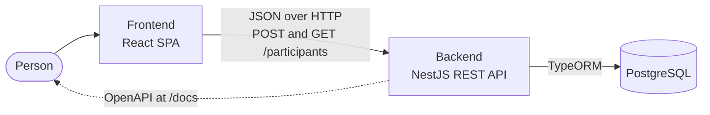
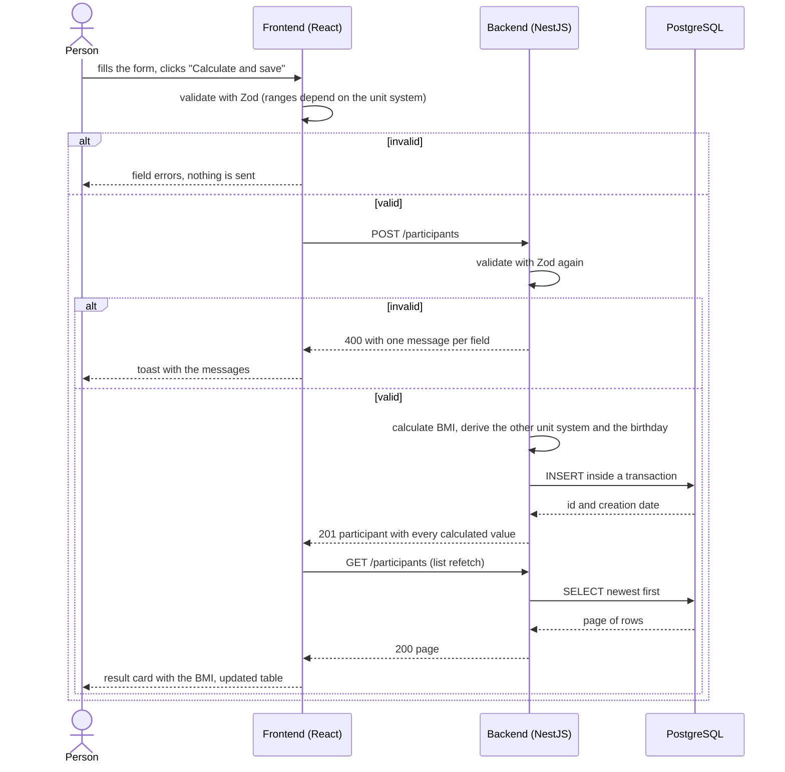
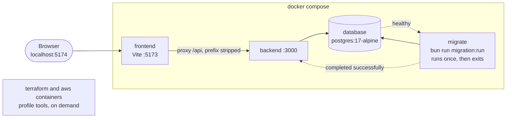
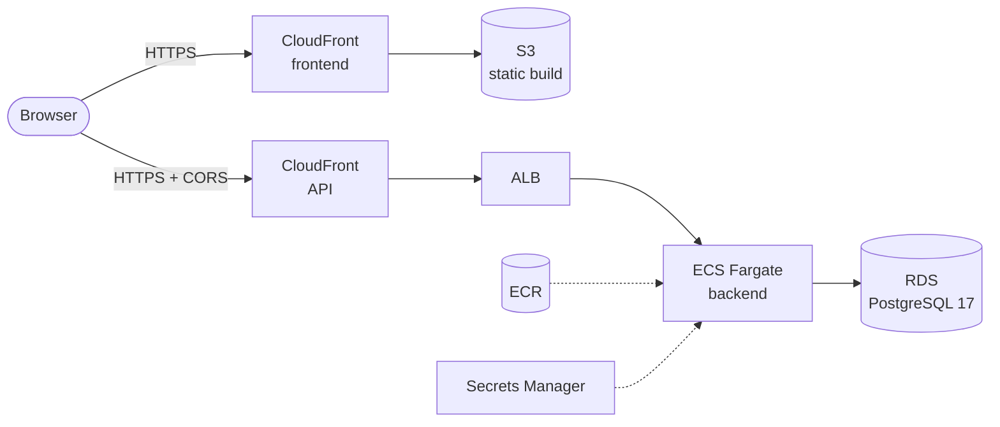
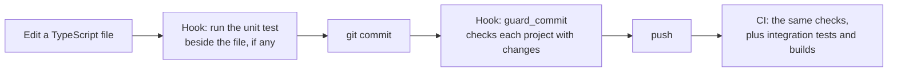

# BMI Tracker

Register participants, calculate each one's Body Mass Index (BMI) in metric or imperial units, and browse everyone registered with a BMI filter and pagination. The creation date is stored with every record.

The feature specification is in [`weight-measuring-feature.md`](weight-measuring-feature.md).

| Part                                    | What it is                                                        | Documentation                                      |
| --------------------------------------- | ----------------------------------------------------------------- | -------------------------------------------------- |
| [`backend/`](backend)                   | NestJS 12 REST API on Bun, TypeORM, PostgreSQL 17, Zod, CQRS      | [backend/README.md](backend/README.md)             |
| [`frontend/`](frontend)                 | React 19 single-page app, Vite 8, TanStack Query, Tailwind, shadcn/ui | [frontend/README.md](frontend/README.md)       |
| [`infrastructure/`](infrastructure)     | Terraform for AWS: S3 + CloudFront, ECS Fargate, ALB, RDS         | [infrastructure/README.md](infrastructure/README.md) |

## Contents

- [How it works](#how-it-works)
- [Quick start](#quick-start)
- [Repository layout](#repository-layout)
- [Commands](#commands)
- [Configuration](#configuration)
- [The BMI calculation](#the-bmi-calculation)
- [Environments](#environments)
- [CI/CD](#cicd)
- [Quality checks](#quality-checks)
- [Differences from the specification](#differences-from-the-specification)
- [Conventions](#conventions)

## How it works



The person fills a form in the SPA. The SPA validates it with Zod and sends it to the API. The API validates it again, calculates the BMI and the other unit system, stores the row and answers with everything it calculated. The SPA shows the result and refreshes the participants table.

### Creating a participant, end to end



## Quick start

You need Docker (with Compose) and `make`. Nothing else is installed on the host: the toolchain runs in containers.

```bash
make up           # creates .env from .env.example, then starts the database,
                  # runs the migrations, and starts the backend and the frontend
```

| What               | Where                              |
| ------------------ | ---------------------------------- |
| App                | http://localhost:5174              |
| API                | http://localhost:3001              |
| API docs (OpenAPI) | http://localhost:3001/docs         |
| PostgreSQL         | `localhost:5432` (user and database from `.env`) |

```bash
make logs         # follow every service
make down         # stop, keep the data
make clean        # stop and DELETE the database volume
```

Source edits hot-reload: `backend/src` and `frontend/src` are bind-mounted into the containers. Changes to `package.json`, a `Dockerfile`, `tsconfig.json`, `eslint.config.mjs`, `vite.config.ts` or `frontend/index.html` need `make up` again, which rebuilds. Editing `.env` also needs `make up`, to recreate the containers.

The local stack:



## Repository layout

```text
.
├── backend/                  # NestJS API. README: backend/README.md
├── frontend/                 # React SPA. README: frontend/README.md
├── infrastructure/           # Terraform for AWS. README: infrastructure/README.md
│   ├── bootstrap/            #   the S3 bucket that holds the Terraform state
│   ├── modules/              #   network, rds, ecr, iam, alb, ecs-*, cdn, monitoring, oidc
│   └── environments/prod/    #   the root module that wires the modules together
├── .github/workflows/
│   ├── ci.yml                # checks on every push and pull request
│   └── deploy.yml            # ships the app after the checks pass on main
├── docker-compose.yml        # database, migrate, backend, frontend, and the tools profile
├── Makefile                  # the single entry point for every command
├── .env.example              # copied to .env by `make env`
├── weight-measuring-feature.md   # the specification
└── CLAUDE.md                 # conventions and architecture notes for Claude Code
```

Each project has its own `package.json` and `bun.lock`. There is no root `package.json`: install dependencies inside `backend/` or `frontend/`, never at the root.

## Commands

Everything runs in containers through `make`. `make help` lists every target.

| Command                                | What it does                                                          |
| -------------------------------------- | --------------------------------------------------------------------- |
| `make up` / `make dev`                 | Start everything, detached / in the foreground with logs              |
| `make down` / `make clean`             | Stop, keep the data / stop and delete the database volume             |
| `make logs`, `make ps`                 | Follow logs, list containers                                          |
| `make migrate`                         | Run pending migrations                                                |
| `make migration-generate name=AddFoo`  | Diff the entities against the database into a new migration           |
| `make migration-create name=AddFoo`    | Create an empty migration                                             |
| `make migration-show` / `migration-revert` | List migrations / revert the last one                             |
| `make db-shell`                        | `psql` in the database container                                      |
| `make backend-shell`, `frontend-shell` | A shell in a container                                                |
| `make typecheck`                       | Backend and frontend `tsc --noEmit`                                   |
| `make lint`                            | Backend ESLint, zero warnings allowed                                 |
| `make test`                            | Backend unit and integration tests, frontend unit tests               |
| `make backend-test-unit`               | Backend unit tests, no database                                       |
| `make backend-test-int`                | Backend integration tests on the database `bmi_test`, created on demand |
| `make format-check` / `make format`    | Prettier check / write (frontend)                                     |
| `make infra-validate`                  | Terraform format check and validate, no AWS access needed             |
| `make infra-apply`                     | Create or update all of prod in AWS                                   |
| `make gh-vars`                         | Print the GitHub Actions variables, from the Terraform outputs        |

## Configuration

`.env.example` documents every variable. `make env` copies it to `.env` (never committed).

| Variable                                          | Purpose                                                                         |
| ------------------------------------------------- | ------------------------------------------------------------------------------- |
| `NODE_ENV`, `PORT`                                | Backend mode and port (inside the container)                                    |
| `DB_HOST`, `DB_PORT`, `DB_USER`, `DB_PASSWORD`, `DB_NAME` | Database connection, read by the backend, the migration container and Postgres |
| `DB_SSL`                                          | `true` in AWS, where RDS requires encrypted connections                         |
| `CORS_ORIGINS`                                    | Browser origins allowed to call the API. Empty locally: Vite proxies `/api`     |
| `DB_EXPOSED_PORT`, `BACKEND_EXPOSED_PORT`, `FRONTEND_EXPOSED_PORT` | Host ports mapped to the containers                            |

The backend validates its environment at start-up with Zod and refuses to boot on an invalid value. It never reads `.env` itself; Docker Compose fills `process.env`.

## The BMI calculation

| Unit system | Weight | Height | Formula                              |
| ----------- | ------ | ------ | ------------------------------------ |
| Metric      | kg     | m      | `BMI = weightKg / heightM²`          |
| Imperial    | lb     | in     | `BMI = (weightLb / heightIn²) × 703` |

- The values the person entered are stored as given. The other unit system is derived (`1 lb = 0.45359237 kg`, `1 in = 0.0254 m`) and rounded to 2 decimals.
- The BMI is computed from the entered values and rounded to 2 decimals.
- Accepted ranges: imperial 2 to 1500 lb and 10 to 120 in; metric 1 to 700 kg and 0.25 to 3 m.
- The API takes the person's `age` and derives the `birthday` (the same calendar day, `age` years back, at midnight UTC).

The details, the API reference and the data model are in [backend/README.md](backend/README.md).

## Environments

### Local

Described in [Quick start](#quick-start). The browser talks only to the Vite server, which forwards `/api` to the backend, so there is no CORS.

### Production (AWS)



- The frontend is static files in a private S3 bucket, served by CloudFront.
- The backend is a Fargate service behind an ALB that only accepts CloudFront's addresses. A second CloudFront distribution gives the API HTTPS without a domain.
- The database is RDS PostgreSQL in private subnets. Its credentials live in Secrets Manager.
- Migrations run as a separate one-shot ECS task before each release.
- The API address is baked into the frontend bundle at build time (`VITE_API_BASE_URL`), so the backend needs `CORS_ORIGINS` set to the frontend's CloudFront origin.

Full detail, with network and security diagrams, in [infrastructure/README.md](infrastructure/README.md).

## CI/CD

```mermaid
flowchart LR
    subgraph ci["ci.yml (push to main, pull requests)"]
        direction TB
        b["backend<br/>typecheck, lint, tests, prod image build"]
        f["frontend<br/>format-check, typecheck, tests, build"]
        i["infra<br/>terraform fmt and validate"]
    end
    ci -->|"all green, push to main only"| d["deploy.yml"]
    d --> s1["1. build and push the image<br/>tag = commit SHA"]
    s1 --> s2["2. register task definitions<br/>with the new image"]
    s2 --> s3["3. run migrations<br/>one-shot ECS task"]
    s3 --> s4["4. update the service<br/>wait, check no rollback"]
    s4 --> s5["5. GET /health"]
    s5 --> s6["6. build the frontend,<br/>sync to S3, invalidate CloudFront"]
```



- Pull requests run the three checks and never deploy.
- A red check never reaches production: `deploy` needs all three.
- Authentication to AWS uses GitHub OIDC; there are no stored credentials. The deploy role trusts only runs on `main`.
- **Terraform is never applied by CI.** Infrastructure changes are applied by hand with `make infra-plan` and `make infra-apply`.
- `deploy.yml` can also be started by hand (`workflow_dispatch`) to redeploy without a new commit. That skips the checks.

First-time setup of the AWS side (`make infra-apply`, then `make gh-vars`) is described in [infrastructure/README.md](infrastructure/README.md#create-everything).

## Quality checks



Locally, the commit guard runs, for each project with pending changes:

| Project        | Checks                                                  |
| -------------- | ------------------------------------------------------- |
| backend        | `make backend-typecheck backend-lint backend-test-unit` |
| frontend       | `make format-check frontend-typecheck frontend-test`    |
| infrastructure | `make infra-validate`                                   |

The integration tests stay out of the commit guard; CI and `make test` run them. These hooks live in `.claude/` and run in Docker, so Docker must be running.

## Differences from the specification

The implementation follows `weight-measuring-feature.md` with these deliberate deviations:

| Specification                              | Implementation                                                                 |
| ------------------------------------------ | ------------------------------------------------------------------------------ |
| `LastName` captured                        | Validated by the API, **not stored**: the table has no column for it           |
| `Birthdate` captured                       | The API takes `age` and stores a derived `birthday`                            |
| `cicd/` folder with GitHub Actions         | Workflows live in `.github/workflows/`, because GitHub only runs them there   |
| `HeigntInMeters` and `WeightInLibs` spelling | Kept as written in the entity fields (`heigntInMeters`, `weightInLibs`) and column `heignt_in_meters`; renaming needs a migration |
| `GET /participants` filters and paginates  | Same, plus `page` (default 1) and `limit` (default 20, max 100); newest first  |

The monorepo adds Terraform environments, a state bootstrap, and a deploy pipeline beyond the sketch in the specification.

## Conventions

The short version; [`CLAUDE.md`](CLAUDE.md) has the full architecture notes.

- **Backend layers** point one way: `routers → use-cases → persistency`. A use case imports ports (abstract classes), never adapters. Writes go through one app-wide unit of work.
- **Errors**: handlers throw domain errors (`NotFoundError` 404, `ConflictError` 409, `BusinessRuleError` 422), never HTTP exceptions.
- **Frontend**: a folder per component with `index.tsx` (JSX only), `hooks/`, `apis/`, `constants/`, `components/`, `tests/`.
- **Contracts are mirrored by hand.** The backend `*.contract.ts` files, the frontend `participant.contract.ts`, and the measurement limits and conversion factors exist on both sides, and nothing syncs them. Change both together.
- **No `any`**, no `@ts-ignore` or `@ts-expect-error`. Validate untyped data with Zod instead of casting.
- **Schema changes** go through a migration. Read the generated file: TypeORM emits a rename as drop plus create.
- **Migrations must be backward compatible**, because they run while the previous release still serves traffic.
- Comments are in English, short, and say *why*.
