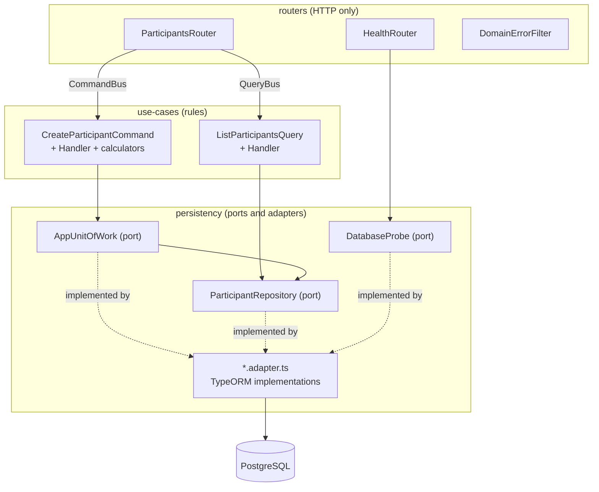
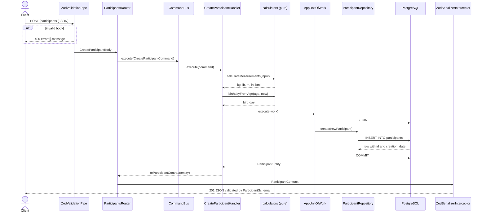

# Backend

REST API that stores participants and calculates their Body Mass Index (BMI). Built with NestJS 12 on Bun, TypeORM and PostgreSQL 17.

- **Runtime:** Bun 1.4 (it runs the TypeScript sources directly, there is no build step)
- **Framework:** NestJS 12 (`@nestjs/cqrs` for the command/query bus)
- **Validation and contracts:** Zod 4 through `nestjs-zod`, so one schema validates the input, serializes the output and documents the route in OpenAPI
- **Persistence:** TypeORM 1.x on PostgreSQL 17, schema changes only through migrations
- **API docs:** OpenAPI UI at `/docs`, JSON at `/docs-json`

Everything runs in Docker through `make` from the repository root. There is no `package.json` at the root: install dependencies inside `backend/` only.

## Contents

- [Run it](#run-it)
- [API](#api)
- [Domain rules](#domain-rules)
- [Package layout](#package-layout)
- [Architecture](#architecture)
- [Request flows](#request-flows)
- [Data model](#data-model)
- [Configuration](#configuration)
- [Migrations](#migrations)
- [Tests](#tests)
- [Lint and typecheck](#lint-and-typecheck)
- [Production image](#production-image)
- [Adding a feature](#adding-a-feature)

## Run it

From the repository root:

```bash
make up          # database + migrations + backend + frontend, detached
make logs        # follow every service
make down        # stop, keep the data
```

The API answers on `http://localhost:3001` (host port `BACKEND_EXPOSED_PORT`; inside the container it listens on `PORT`, 3000). Open `http://localhost:3001/docs` for the interactive OpenAPI UI.

The source is bind-mounted into the container and `bun --watch` reloads on every edit. Changes to `package.json`, `Dockerfile`, `tsconfig.json` or `eslint.config.mjs` need a rebuild (`make up` does it).

Compose starts `database`, then `migrate` (runs the migrations once and exits), then `backend`, which starts only after the migrations finished successfully. `migrate` and `backend` share the image `bmi-backend:dev`.

## API

All routes are validated by the global `ZodValidationPipe` and every response is validated against its schema by `ZodSerializerInterceptor`.

| Method | Path            | Purpose                                                              | Success |
| ------ | --------------- | -------------------------------------------------------------------- | ------- |
| `POST` | `/participants` | Store a participant. Returns every calculated value and the assigned id. | `201`   |
| `GET`  | `/participants` | List participants, newest first. Optional BMI range filter, paginated.   | `200`   |
| `GET`  | `/health`       | Liveness probe: runs `SELECT 1` against the database.                | `200`, or `503` when the database does not answer |

### `POST /participants`

Request body:

| Field        | Type                        | Rules                                                            |
| ------------ | --------------------------- | ---------------------------------------------------------------- |
| `firstName`  | string                      | trimmed, 1 to 100 characters                                     |
| `lastName`   | string                      | trimmed, 1 to 100 characters. Validated but **not stored** (the table has no column for it) |
| `email`      | string                      | valid email, at most 255 characters                              |
| `phone`      | string                      | `^\+?[0-9 ()\-.]{7,30}$`                                         |
| `unitPicked` | `"imperial"` or `"metric"`  | decides how `weight` and `height` are read                       |
| `weight`     | number                      | positive and inside the range of the picked unit system          |
| `height`     | number                      | positive and inside the range of the picked unit system          |
| `age`        | integer                     | 0 to 120. The API derives the birthday from it                   |

Accepted ranges:

| Unit system | Weight          | Height            |
| ----------- | --------------- | ----------------- |
| `imperial`  | 2 to 1500 lb    | 10 to 120 in      |
| `metric`    | 1 to 700 kg     | 0.25 to 3 m       |

Example:

```bash
curl -X POST http://localhost:3001/participants \
  -H 'content-type: application/json' \
  -d '{
    "firstName": "Ada", "lastName": "Lovelace", "email": "ada@example.com",
    "phone": "+1 555 123 4567", "unitPicked": "imperial",
    "weight": 154.3, "height": 69, "age": 30
  }'
```

Response `201`:

```json
{
  "id": 1,
  "firstName": "Ada",
  "email": "ada@example.com",
  "phone": "+1 555 123 4567",
  "unitPicked": "imperial",
  "weightInLbs": 154.3,
  "weightInKilos": 69.99,
  "heightInInches": 69,
  "heightInMeters": 1.75,
  "bmi": 22.78,
  "birthday": "1996-11-06T00:00:00.000Z",
  "creationDate": "2026-11-06T15:04:05.000Z"
}
```

### `GET /participants`

| Query param | Type    | Default | Rules                                         |
| ----------- | ------- | ------- | --------------------------------------------- |
| `minBmi`    | number  | none    | 0 or more. Inclusive                          |
| `maxBmi`    | number  | none    | 0 or more. Inclusive. `minBmi` must be `<= maxBmi` |
| `page`      | integer | `1`     | 1 or more                                     |
| `limit`     | integer | `20`    | 1 to 100                                      |

Response `200`:

```json
{ "items": [ /* participants, same shape as above */ ], "total": 42, "page": 1, "limit": 20, "totalPages": 3 }
```

Ordering is `creation_date DESC, id DESC`. `total` counts every match, not only the current page.

### Errors

| Cause                                                     | Status                  |
| --------------------------------------------------------- | ----------------------- |
| The body or query fails validation (`ZodValidationPipe`)  | `400`                   |
| `NotFoundError`                                           | `404`                   |
| `ConflictError`                                           | `409`                   |
| `BusinessRuleError`                                       | `422`                   |
| Any other `DomainError`, which is also logged             | `500`                   |
| Any other exception                                       | `500` (Nest default)    |

- Handlers throw `NotFoundError`, `ConflictError` or `BusinessRuleError` from `src/shared/domain/domain-error.ts`, never HTTP exceptions. `DomainErrorFilter` is the only place that knows the status codes. It answers `{ statusCode, message, error }`.
- The validation `400` carries `errors[].message`, one entry per invalid field. The frontend's `request.ts` reads that shape: keep it.
- No handler throws a domain error yet. The mapping is in place and tested for the first rule that needs it. A uniqueness rule must also have a unique index; a handler pre-check is only the friendly path.

## Domain rules

`calculateMeasurements` (`create-participant/measurements.calculator.ts`) is a pure function:

- The value the person entered is **kept as given**. The other unit system is derived and rounded to 2 decimals.
- The BMI is computed from the **entered** values and rounded to 2 decimals.

| Unit system | Formula                              | Derived values                                  |
| ----------- | ------------------------------------ | ----------------------------------------------- |
| `metric`    | `BMI = weightKg / heightM²`          | `lb = kg / 0.45359237`, `in = m / 0.0254`       |
| `imperial`  | `BMI = (weightLb / heightIn²) × 703` | `kg = lb × 0.45359237`, `m = in × 0.0254`       |

`birthdayFromAge` (`birthday.calculator.ts`) is approximate: the same calendar day, `age` years back, at midnight UTC.

The ranges and conversion factors are duplicated in the frontend (`measurement-limits.ts`, `unit-conversion.ts`). Change both sides together.

## Package layout

The code is split in five top-level packages under `src/`, plus the migrations. Each package is a folder with an import alias.

```text
backend/
├── Dockerfile                         # stages: base, dev, prod-deps, prod-src, prod
├── package.json                       # scripts: start, test:unit, test:int, migration:*
├── tsconfig.json                      # strict TS, path aliases #config/* ... #shared/*
├── eslint.config.mjs                  # type-aware rules, zero warnings
├── src/
│   ├── main.ts                        # bootstrap: Nest app, shutdown hooks, OpenAPI, CORS
│   ├── app.module.ts                  # root module + global pipe, interceptor and filter
│   │
│   ├── config/                        # #config/*  imports no other package
│   │   ├── env/                       #   env.schema.ts (Zod), env.module.ts
│   │   ├── database/                  #   database.options.ts, data-source.ts (TypeORM CLI)
│   │   └── openapi/                   #   openapi.document.ts, openapi.ui.ts
│   │
│   ├── routers/                       # #routers/*  HTTP in, HTTP out
│   │   ├── participants.router.ts     #   POST and GET /participants
│   │   ├── health.router.ts           #   GET /health
│   │   ├── routers.module.ts
│   │   ├── http/                      #   domain-error.filter.ts, types/
│   │   └── tests/
│   │
│   ├── use-cases/                     # #use-cases/*  one folder per use case
│   │   ├── use-cases.module.ts        #   CqrsModule + the groups
│   │   ├── health/                    #   health.contract.ts
│   │   └── participants/
│   │       ├── participants.use-cases.module.ts
│   │       ├── participant.contract.ts    # shared by several use cases
│   │       ├── participant.mapper.ts      # entity -> contract, the only place
│   │       ├── create-participant/
│   │       │   ├── create-participant.contract.ts   # Zod input
│   │       │   ├── create-participant.command.ts
│   │       │   ├── create-participant.handler.ts
│   │       │   ├── measurements.calculator.ts       # pure
│   │       │   ├── birthday.calculator.ts           # pure
│   │       │   ├── constants/               # measurement-limits.ts, unit-conversion.ts
│   │       │   └── tests/
│   │       ├── list-participants/
│   │       │   ├── list-participants.contract.ts
│   │       │   ├── list-participants.query.ts
│   │       │   ├── list-participants.handler.ts
│   │       │   └── tests/
│   │       └── tests/
│   │
│   ├── persistency/                   # #persistency/*  ports and adapters
│   │   ├── persistency.module.ts      #   the only place a port is bound to its adapter
│   │   ├── models/                    #   participant.entity.ts
│   │   ├── repositories/
│   │   │   ├── base.repository.ts     #   uses the open transaction if any
│   │   │   └── participant/           #   participant.repository.ts (port)
│   │   │                              #   participant.repository.adapter.ts, types/
│   │   ├── transactions/
│   │   │   ├── transaction-context.ts #   AsyncLocalStorage with the open EntityManager
│   │   │   ├── unit-of-work.ts        #   generic port
│   │   │   ├── unit-of-work.adapter.ts
│   │   │   └── app/                   #   app.unit-of-work.ts (port), .adapter.ts, types/
│   │   └── probes/database/           #   database.probe.ts (port), .adapter.ts
│   │
│   ├── shared/                        # #shared/*  imports no other package
│   │   └── domain/domain-error.ts     #   NotFoundError, ConflictError, BusinessRuleError
│   │
│   └── migrations/                    # TypeORM migrations, found by glob
│       └── 1793913261584-CreateParticipants.ts
│
└── test/                              # integration tests, boot the real AppModule
    ├── routers/                       #   health, openapi, participants
    ├── persistency/                   #   participant.repository, app.unit-of-work
    └── support/                       #   setup.ts, test-app.ts, http.ts, rejection.ts, types/
```

| Package        | Alias            | Holds                                                         | May import                                  |
| -------------- | ---------------- | ------------------------------------------------------------- | ------------------------------------------- |
| `config/`      | `#config/*`      | Env schema, data source options, OpenAPI setup                | nothing from the other packages             |
| `shared/`      | `#shared/*`      | Domain errors, free of HTTP                                   | nothing from the other packages             |
| `persistency/` | `#persistency/*` | Entities, repositories, unit of work, probes                  | `config/`                                   |
| `use-cases/`   | `#use-cases/*`   | Contracts, commands, queries, handlers, calculators           | `persistency/` (ports only), `shared/`      |
| `routers/`     | `#routers/*`     | Controllers, the error filter                                 | `use-cases/`, `shared/`, and `persistency/` for the health probe port only |

Inside one package, use relative paths. Crossing a package uses the alias. Code loaded by tooling that does not resolve aliases (`test/support/setup.ts`, the TypeORM CLI through `config/database/data-source.ts`) must use relative imports.

## Architecture

Dependencies point one way: `routers → use-cases → persistency`. `config/` imports no layer. Crossing a layer uses the tsconfig aliases `#config/*`, `#routers/*`, `#use-cases/*`, `#persistency/*`, `#shared/*`. Inside a layer, use relative paths.



### Layers

- **Routers** (`routers/*.router.ts`) turn HTTP into a command or a query and return the result. Every route uses `@ZodResponse`, health included; `test/routers/openapi.int-spec.ts` fails if a success response has no schema. `HealthRouter` is the one router that skips the bus on purpose: it has no rule and no transaction, and the orchestrator polls it often.
- **Use cases** (`use-cases/<group>/<use-case>/`) hold one feature each: `*.contract.ts` (Zod input), `*.command.ts` or `*.query.ts` (extend `Command<TResult>` / `Query<TResult>`, so `bus.execute` is typed), `*.handler.ts`, and pure calculators with their `constants/`. A schema lives at the narrowest level that uses it; only what several use cases share goes in `<group>/<name>.contract.ts`.
- **Persistency** has abstract classes as ports (`participant.repository.ts`, `transactions/app/app.unit-of-work.ts`) and `*.adapter.ts` files as adapters. `persistency.module.ts` is the only place that binds a port to its adapter. Use cases import ports, never adapters.
- **Config** (`config/`): `EnvSchema` (Zod) is the single source of environment variables. `buildDataSourceOptions` is shared by the Nest app and the TypeORM CLI and finds entities and migrations by glob, so it imports nothing from persistency.

Dependency injection is explicit: every constructor parameter carries `@Inject(Token)`, and a port (an abstract class) is its own token.

### Unit of work

One `AppUnitOfWork` serves the whole app. Writes go through it; reads (`ListParticipantsHandler`) may use the repository directly.

`execute(work)` asks `TransactionContext` whether a transaction is open. If none is, it opens one with `DataSource.transaction` and runs `work` inside `TransactionContext.run`, so every repository finds that transaction; it commits when `work` resolves and rolls back when `work` throws. If one is already open, `work` joins it.

- `TransactionContext` stores the open `EntityManager` in an `AsyncLocalStorage`, so repositories find the transaction without receiving it as a parameter.
- `BaseRepository` uses the open transaction if there is one, otherwise the plain connection. Repositories never commit.
- A nested `execute` joins the outer transaction.
- A new repository is added to `AppRepositories` (`transactions/app/types/`) and to `AppUnitOfWorkAdapter`.

## Request flows

### Create a participant



### List participants

`GET /participants` goes through `ZodValidationPipe` (numbers coerced, defaults applied), then `ListParticipantsQuery` and `ListParticipantsHandler`. The handler calls `ParticipantRepository.search` with `offset = (page - 1) * limit`, which filters with `bmi >= minBmi AND bmi <= maxBmi` and orders by `creation_date DESC, id DESC`. It answers the mapped items plus `total`, `page`, `limit` and `totalPages`. It reads through the repository directly, with no unit of work.

## Data model

| Column             | Type               | Notes                                    |
| ------------------ | ------------------ | ---------------------------------------- |
| `id`               | `SERIAL`           | primary key                              |
| `first_name`       | `varchar(100)`     |                                          |
| `email`            | `varchar(255)`     | not unique                               |
| `phone`            | `varchar(30)`      |                                          |
| `weight_in_libs`   | `double precision` |                                          |
| `height_in_inches` | `double precision` |                                          |
| `weight_in_kilos`  | `double precision` |                                          |
| `heignt_in_meters` | `double precision` | spelling copied from the spec            |
| `unit_picked`      | `varchar(10)`      | check `chk_participants_unit_picked`: `imperial` or `metric` |
| `creation_date`    | `timestamptz`      | default `now()`                          |
| `bmi`              | `double precision` |                                          |
| `birthday`         | `timestamptz`      |                                          |

Every column is `NOT NULL`.

- `heignt_in_meters` and the entity fields `weightInLibs` / `heigntInMeters` copy the spelling of `weight-measuring-feature.md`. Do not "fix" them without a migration.
- There is no unique index on `email`: the same email can be registered twice.
- `last_name` does not exist; the API validates `lastName` and drops it.
- The spec stores `Birthdate`; the API takes `age` and stores the derived `birthday`.

## Configuration

`EnvSchema` (`src/config/env/env.schema.ts`) validates `process.env` at start-up and the app refuses to boot on an invalid value. The backend never reads `.env` itself (`ignoreEnvFile: true`): Docker Compose fills the environment from `.env`, and in AWS the task definition does.

| Variable       | Default       | Purpose                                                                              |
| -------------- | ------------- | ------------------------------------------------------------------------------------ |
| `NODE_ENV`     | `development` | `development`, `production` or `test`                                                |
| `PORT`         | `3000`        | Port the server listens on (bound to `0.0.0.0`)                                      |
| `DB_HOST`      | required      | Database host                                                                        |
| `DB_PORT`      | `5432`        | Database port                                                                        |
| `DB_USER`      | required      | Database user                                                                        |
| `DB_PASSWORD`  | required      | Database password                                                                    |
| `DB_NAME`      | required      | Database name                                                                        |
| `DB_SSL`       | `false`       | `true` encrypts the connection without verifying the certificate (RDS requires it)   |
| `CORS_ORIGINS` | empty         | Comma-separated browser origins. Empty in development (Vite proxies `/api`); in production it holds the frontend's CloudFront origin. `main.ts` enables CORS only when it is not empty |

`.env.example` at the repository root lists the values for local development. In AWS, `DB_USER` and `DB_PASSWORD` come from Secrets Manager.

## Migrations

`synchronize` is `false`: the schema changes only through a migration in `src/migrations/`. The order is: edit the entity, `make migrate` (brings the database to the current head), `make migration-generate name=AddFoo`, read the generated file, `make migrate`.

```bash
make migrate                           # apply pending migrations
make migration-generate name=AddFoo    # diff entities against the live database
make migration-create name=AddFoo      # empty migration
make migration-show                    # which ran
make migration-revert                  # undo the last one
```

Read the generated file before applying it: TypeORM emits a rename as drop plus create, which loses data.

In production the migrations run as a separate one-shot ECS task before the service moves to the new image (see [infrastructure/README.md](../infrastructure/README.md)). They run while the old tasks still serve traffic, so each migration must work with the previous code too: add a column before the code uses it, drop it in a later release.

## Tests

| Kind        | Files                                  | Needs DB | Command                      |
| ----------- | -------------------------------------- | -------- | ---------------------------- |
| Unit        | `src/**/tests/*.unit-spec.ts`          | no       | `make backend-test-unit`     |
| Integration | `test/**/*.int-spec.ts`                | yes      | `make backend-test-int`      |
| Both        |                                        |          | `make backend-test`          |

- Unit specs sit in a `tests/` folder beside the code they cover.
- Integration specs boot the real `AppModule` (with its global pipe, interceptor and filter) on a random port against Postgres. `test/support/setup.ts` creates the database `bmi_test` if needed, runs the migrations on it and refuses any `DB_NAME` that does not end in `_test`. `testApp.reset()` truncates every table except `migrations` between tests.
- Persistency has its own specs: `participant.repository.int-spec.ts` (search, filters, ordering) and `app.unit-of-work.int-spec.ts` (rollback).
- Response bodies are `unknown`: validate them with `bodyOf(response, Schema)` (`test/support/http.ts`). Use `rejectionOf(promise)` instead of `await expect().rejects`.

Run a single file (the path must start with `./`, otherwise Bun treats it as a name filter and reports no match):

```bash
docker compose run --rm --no-deps backend bun test ./src/use-cases/participants/create-participant/tests/measurements.calculator.unit-spec.ts
docker compose run --rm backend sh -c 'DB_NAME=bmi_test bun test --preload ./test/support/setup.ts ./test/routers/participants.int-spec.ts'
```

## Lint and typecheck

```bash
make backend-typecheck   # tsc --noEmit
make backend-lint        # ESLint, zero warnings allowed
```

- ESLint is type-aware and enforces `no-explicit-any`, `no-unsafe-type-assertion` and `ban-ts-comment`. `noInlineConfig` is on, so `eslint-disable` comments do nothing: an exception goes in `eslint.config.mjs`, scoped to a path.
- `tsconfig.json` sets `noUncheckedIndexedAccess` and `noImplicitOverride`.
- `package.json` aliases `typescript` to TypeScript 6 (`@typescript/typescript6`) because typescript-eslint does not support TypeScript 7 yet; `tsc` still runs TypeScript 7 through `@typescript/native`. Do not remove the alias until typescript-eslint supports TypeScript 7.
- Code loaded by tooling without alias support (`test/support/setup.ts`, the TypeORM CLI through `data-source.ts`) must use relative imports.

## Production image

`Dockerfile` has these stages:

| Stage       | Purpose                                                                                  |
| ----------- | ---------------------------------------------------------------------------------------- |
| `base`      | Bun on Alpine, copies `package.json` and `bun.lock`                                      |
| `dev`       | All dependencies, runs `bun run start:dev`; the source is bind-mounted by Compose        |
| `prod-deps` | Production dependencies only                                                             |
| `prod-src`  | The sources with every `tests/` folder removed                                           |
| `prod`      | `NODE_ENV=production`, runs as the non-root `bun` user with `bun run start`              |

The same image runs the API (`bun run start`) and the migrations (`bun run migration:run`). `make backend-image` builds the `prod` target to check the Dockerfile.

## Adding a feature

1. Create `use-cases/<group>/<use-case>/` with the contract, the command or query, the handler and any pure calculator. Register the handler in the group's `*.use-cases.module.ts`.
2. If it needs data access, add a method to the port (`*.repository.ts`) and implement it in the adapter (`*.repository.adapter.ts`). A new repository also goes in `AppRepositories` and `AppUnitOfWorkAdapter`, and gets bound in `persistency.module.ts`.
3. Add a route to a router with `@ZodResponse`. The response schema must be documented, or the OpenAPI spec fails.
4. If an entity changed, generate and read a migration.
5. Add unit specs beside the code and an integration spec in `test/`.
6. If the contract changed, update the frontend copy in `frontend/src/components/ParticipantsPage/apis/participant.contract.ts` in the same change.
