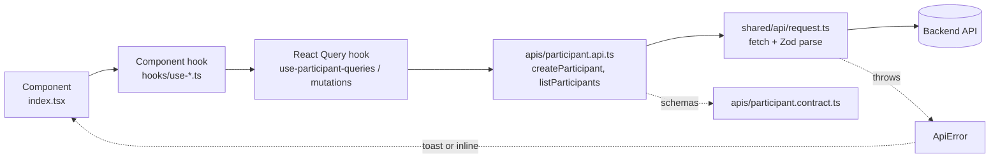
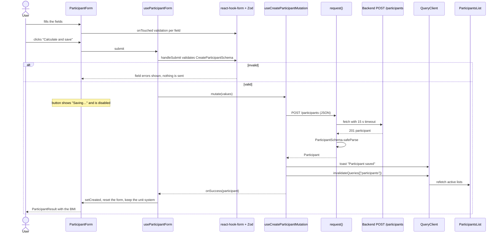

# Frontend

Single-page app to register participants, see their calculated BMI, and browse everyone registered with a BMI filter and pagination.

- **UI:** React 19, Tailwind CSS 4, shadcn/ui (Radix primitives), Sonner toasts
- **Data:** TanStack Query 5 for server state
- **Forms and validation:** react-hook-form with a Zod 4 resolver
- **Build and dev server:** Vite 8 on Bun
- **Tests:** Vitest 5, React Testing Library, jsdom
- **Formatting:** Prettier (single quotes, semicolons, trailing commas, width 100)

Everything runs in Docker through `make` from the repository root. There is no `package.json` at the root: install dependencies inside `frontend/` only.

## Contents

- [Run it](#run-it)
- [What the user sees](#what-the-user-sees)
- [Package layout](#package-layout)
- [Data flow](#data-flow)
- [Error handling](#error-handling)
- [API contract](#api-contract)
- [Configuration](#configuration)
- [Tests](#tests)
- [Production build](#production-build)
- [Working with shadcn/ui](#working-with-shadcnui)
- [Adding a component](#adding-a-component)

## Run it

From the repository root:

```bash
make up           # database + migrations + backend + frontend, detached
make logs         # follow every service
```

Open `http://localhost:5174` (host port `FRONTEND_EXPOSED_PORT`; the Vite server listens on 5173 inside the container).

`frontend/src` is bind-mounted into the container, so edits reload instantly. Changes to `package.json`, `Dockerfile`, `tsconfig.json`, `vite.config.ts` or `index.html` need a rebuild (`make up` does it).

Checks:

```bash
make frontend-typecheck   # tsc --noEmit
make frontend-test        # Vitest
make format-check         # Prettier --check (CI runs it)
make format               # Prettier --write
make frontend-build       # typecheck + production bundle, to verify the build
```

## What the user sees

One page, no router. `main.tsx` renders `ParticipantsPage` directly.

| Area                | What it does                                                                                                                                                                                                                                                  |
| ------------------- | ------------------------------------------------------------------------------------------------------------------------------------------------------------------------------------------------------------------------------------------------------------- |
| **New participant** | Form with first name, last name, email, phone, unit system (Metric or Imperial), weight, height and age. Validates as you leave each field and again on submit. After saving, it shows the participant's id, BMI, and weight and height in both unit systems. |
| **Participants**    | Table of everyone registered, newest first, 10 per page. BMI filter (minimum, maximum or both), pagination, and loading, empty and error states.                                                                                                              |

Behaviors worth knowing:

- Switching Metric/Imperial **converts the values already typed** (rounded to 2 decimals), so they stay valid in the new system.
- After a successful save the form is emptied but keeps the chosen unit system.
- Saving a participant invalidates the list queries, so the table that is on screen refetches without a page reload.
- The table shows weight and height in the unit system the participant picked, and dates as `Nov 6, 2026` (UTC).
- Applying or clearing the BMI filter returns to page 1.

## Package layout

The app is split in four top-level packages under `src/`: `components/` (screens and UI), `shared/` (code with no screen), `test/` (test helpers) and the entry files. Inside `components/`, every component is its own folder, recursively, and uses only the sub-folders it needs.

```text
frontend/
├── Dockerfile                         # stages: dev, build, dist (static files only)
├── package.json                       # scripts: dev, build, typecheck, test, format
├── vite.config.ts                     # React + Tailwind plugins, @ alias, /api proxy, Vitest
├── components.json                    # shadcn/ui config (new-york, neutral, Lucide)
├── index.html
└── src/
    ├── main.tsx                       # StrictMode > ErrorBoundary > QueryClientProvider
    ├── index.css                      # Tailwind entry and theme tokens
    │
    ├── components/                    # @/components/*
    │   ├── ErrorBoundary/             #   class component: React has no hook for render errors
    │   │   ├── index.tsx
    │   │   ├── components/ErrorFallback/
    │   │   ├── types/
    │   │   └── tests/
    │   │
    │   ├── ParticipantsPage/          #   the one screen
    │   │   ├── index.tsx              #     JSX only: form on one side, list on the other
    │   │   ├── apis/                  #     participant.contract.ts (Zod) + participant.api.ts
    │   │   ├── hooks/                 #     participant.keys.ts, use-participant-queries.ts,
    │   │   │                          #     use-participant-mutations.ts
    │   │   ├── constants/             #     measurement-limits.ts, unit-systems.ts
    │   │   ├── tests/                 #     page test, fixture, fill-participant-form.ts
    │   │   └── components/
    │   │       ├── ParticipantForm/
    │   │       │   ├── index.tsx
    │   │       │   ├── hooks/                 # use-participant-form.ts
    │   │       │   ├── constants/             # form-defaults.ts, unit-conversion.ts
    │   │       │   ├── measurement.converter.ts
    │   │       │   ├── tests/
    │   │       │   └── components/
    │   │       │       ├── PersonalFields/
    │   │       │       ├── MeasurementFields/     # + hooks/, types/
    │   │       │       ├── UnitSystemToggle/      # + hooks/, types/
    │   │       │       ├── FormField/             # + hooks/, types/
    │   │       │       └── ParticipantResult/
    │   │       └── ParticipantsList/
    │   │           ├── index.tsx
    │   │           ├── hooks/                 # use-participants-list.ts
    │   │           ├── constants/             # page-size.ts
    │   │           ├── types/                 # bmi-filter.types.ts
    │   │           ├── tests/
    │   │           └── components/
    │   │               ├── BmiFilter/             # + hooks/, types/, tests/
    │   │               ├── ParticipantsTable/     # + participant.formatter.ts, tests/
    │   │               └── Pagination/            # + types/
    │   │
    │   └── ui/                        #   shadcn primitives, one folder per component
    │       ├── Button/                #     + constants/button-variants.ts
    │       ├── Card/                  #     + components/ (CardHeader, CardTitle, ...)
    │       ├── Input/
    │       ├── Label/
    │       ├── Table/                 #     + components/ (TableHeader, TableRow, ...)
    │       ├── Toaster/
    │       └── ToggleGroup/           #     + components/ToggleGroupItem, constants/
    │
    ├── shared/                        # @/shared/*  imports nothing from components/
    │   ├── api/
    │   │   ├── request.ts             #   the transport: fetch + Zod parse
    │   │   ├── api-error.ts           #   ApiError
    │   │   ├── query-client.ts        #   QueryClient with the central error toasts
    │   │   ├── constants/             #   error-messages.ts
    │   │   ├── types/                 #   request-options.types.ts
    │   │   └── tests/
    │   ├── config/constants/          #   api-base-url.ts (VITE_API_BASE_URL)
    │   └── theme/cn.ts                #   class-name helper (clsx + tailwind-merge)
    │
    └── test/                          # helpers for tests only
        ├── setup.ts                   #   jest-dom matchers, cleanup after each test
        ├── render-with-query-client.tsx   # throwaway QueryClient per test
        └── stub-fetch.ts              #   replaces the global fetch for one test
```

| Package             | Alias               | Holds                                                          | May import                                    |
| ------------------- | ------------------- | -------------------------------------------------------------- | --------------------------------------------- |
| `main.tsx`          | none                | The providers and the mount point                              | `components/`, `shared/api/query-client`      |
| `components/<Page>` | `@/components/*`    | A screen: its API calls, hooks, constants and child components | `components/ui`, `shared/`                    |
| `components/ui/`    | `@/components/ui/*` | shadcn primitives with no knowledge of the domain              | `shared/theme/cn`                             |
| `shared/`           | `@/shared/*`        | Transport, error type, query client, config, helpers           | nothing from `components/`                    |
| `test/`             | `@/test/*`          | Render helper, fetch stub, setup                               | third-party packages only; used by tests only |

Dependencies point down: a page uses `ui/` and `shared/`; `ui/` and `shared/` never import a page. Child components reach the `apis/` and `constants/` of the page that owns them (for example the unit toggle imports `participant.contract`).

Inside a component folder:

| Folder / file         | Holds                                                                       |
| --------------------- | --------------------------------------------------------------------------- |
| `index.tsx`           | JSX only. No state, effects or handlers                                     |
| `hooks/`              | State, effects, handlers and React Query hooks                              |
| `apis/`               | `*.contract.ts` Zod schemas and `*.api.ts` calls. Never imports React Query |
| `constants/`          | Constants                                                                   |
| `types/`              | Props and shared types                                                      |
| `components/<Child>/` | Child components, each with the same shape                                  |
| `tests/`              | `*.unit-test.ts` / `*.unit-test.tsx`                                        |

Rules that keep it consistent:

- The import alias `@/` points to `src/`.
- No namespace objects: export plain functions (`listParticipants()`, not `participantApi.list()`).
- No `any`, `@ts-ignore` or `@ts-expect-error`. Validate untyped data with Zod instead of casting.
- Comments in English, short, and they say _why_.

## Data flow

Each component renders; its hook owns the logic. `ParticipantForm` and `ParticipantsList` do not know about each other: they meet only through the React Query cache.

### Layers



`shared/api/request.ts` is the transport. It knows no domain: the caller passes the Zod schema the response must match. Query keys and hooks live in `hooks/`, never in `apis/`.

### Creating a participant



Returning the invalidation promise from `onSuccess` keeps the mutation pending until the lists are refetched, so the button stays disabled until the table is current.

### Listing and filtering

On mount, `useParticipantsList` asks for page 1 with 10 rows (`PAGE_SIZE`). Applying a filter sets `minBmi` and `maxBmi` and returns to page 1; changing the page keeps the filter. Each combination is its own query, for example `GET /participants?minBmi=18&maxBmi=25&page=1&limit=10`, and `keepPreviousData` keeps the old rows on screen while the new page loads.

The query key is `["participants", "list", params]`. The mutation invalidates the prefix `["participants"]`, which covers every filter and page.

### List states

| View      | When                                        | Renders                        |
| --------- | ------------------------------------------- | ------------------------------ |
| `loading` | the first request is pending                | `Loading participants…`        |
| `error`   | the request failed and there is no data yet | the message and a Retry button |
| `empty`   | the answer has no items                     | `No participants found.`       |
| `ready`   | the answer has items                        | the table and the pagination   |

When a request fails but the list already had data, the old rows stay and a toast reports the failure. Only a first load that fails renders the inline error with a Retry button.

### Unit switch

Switching the unit system converts the weight and height already typed, rounded to 2 decimals, and leaves an empty or invalid field alone. It revalidates only if the form was already submitted.

Conversion factors: `1 lb = 0.45359237 kg`, `1 in = 0.0254 m`. The limits per unit system live in `constants/measurement-limits.ts`.

## Error handling

`request.ts` throws one error type, `ApiError`, for everything that can go wrong. The user never sees a raw exception.

| Situation                           | Message                                                                                                                |
| ----------------------------------- | ---------------------------------------------------------------------------------------------------------------------- |
| No connection, or no answer in 15 s | `Could not reach the server`                                                                                           |
| Any 5xx                             | `The server had a problem. Try again in a moment.` (Nest's "Internal server error" or a proxy's HTML page help nobody) |
| 400                                 | The backend's per-field messages from `errors[].message`                                                               |
| Other 4xx                           | The body's `message`, else `Request failed (<status>)`                                                                 |
| Response fails the schema           | `The server sent an answer the app does not understand`                                                                |

Where each failure is shown (`shared/api/query-client.ts`):

- A failed **mutation** always toasts.
- A failed **query** toasts only if it already had data. A first load fails inline with a Retry button.
- Queries retry once; `refetchOnWindowFocus` is off.
- `ErrorBoundary` wraps the whole app and catches render errors. It is a class because React offers no hook for that. Its fallback offers a retry.

## API contract

`apis/participant.contract.ts` holds the Zod schemas for the request, the response and the list params. They mirror the backend contracts by hand: nothing syncs them. **Change both together.**

| Frontend (`ParticipantsPage/`)                            | Backend                                                  |
| --------------------------------------------------------- | -------------------------------------------------------- |
| `apis/participant.contract.ts`                            | `backend/src/use-cases/participants/**/*.contract.ts`    |
| `constants/measurement-limits.ts`                         | `.../create-participant/constants/measurement-limits.ts` |
| `components/ParticipantForm/constants/unit-conversion.ts` | `.../create-participant/constants/unit-conversion.ts`    |

The frontend needs only the schemas; the `createZodDto` classes stay in the backend. The calls:

```ts
createParticipant(input); // POST /participants
listParticipants(params); // GET  /participants?minBmi&maxBmi&page&limit
```

`undefined` params are left out of the query string.

## Configuration

| Variable            | Where it is read          | Default                 | Purpose                                                                                              |
| ------------------- | ------------------------- | ----------------------- | ---------------------------------------------------------------------------------------------------- |
| `VITE_API_BASE_URL` | build time, in the bundle | `/api`                  | Base URL of the API. In production it is the API's CloudFront URL                                    |
| `API_PROXY_TARGET`  | `vite.config.ts` (dev)    | `http://localhost:3001` | Where the dev server forwards `/api`. Compose sets `http://backend:3000`                             |
| `USE_POLLING`       | `vite.config.ts` (dev)    | unset                   | File watching by polling; Compose sets it because bind mounts on Docker Desktop can drop file events |

In development the browser only talks to the Vite server, so there is no CORS. In production the browser calls the API's own CloudFront domain, so the backend needs `CORS_ORIGINS` set to the frontend's origin.

## Tests

```bash
make frontend-test
docker compose run --rm --no-deps frontend bun --bun vitest run src/components/ParticipantsPage/tests/ParticipantsPage.unit-test.tsx
```

- Vitest with the `jsdom` environment; files are `src/**/*.unit-test.{ts,tsx}`, placed in a `tests/` folder beside the code.
- Helpers live in `src/test/`: `render-with-query-client.tsx`, `stub-fetch.ts`, `setup.ts`.
- Shared fixtures for the page: `ParticipantsPage/tests/participant.fixture.ts` and `fill-participant-form.ts`.
- The suite covers the transport (`request.unit-test.ts`), the contracts, the API calls, the unit converter, the formatter, the filter, the list states, the form, the error boundary and the whole page.

## Production build

There is no web server image. The `Dockerfile` has three stages:

| Stage   | Purpose                                                                                        |
| ------- | ---------------------------------------------------------------------------------------------- |
| `dev`   | Installs dependencies and runs `bun run dev`; `src` is bind-mounted                            |
| `build` | Takes `VITE_API_BASE_URL` as a build argument (default `/api`), installs, runs `bun run build` |
| `dist`  | `FROM scratch`, holds only the static files from `/app/dist`                                   |

The deploy workflow exports the `dist` stage, syncs it to S3 and invalidates the CloudFront cache.

Hashed bundles under `assets/` never change under the same name, so they are cached for a year. Everything else, `index.html` first, is fetched again to pick up a new release. See [infrastructure/README.md](../infrastructure/README.md).

## Working with shadcn/ui

`components/ui/` holds the primitives (`Button`, `Card`, `Input`, `Label`, `Table`, `Toaster`, `ToggleGroup`), configured by `components.json` (style `new-york`, base color `neutral`, Lucide icons).

They are reshaped to one folder per component: `ui/Toaster/`, not a flat `sonner.tsx`. `shadcn add` writes flat files, so split them by hand and do not leave the flat file next to the folder.

## Adding a component

1. Create `components/<Parent>/components/<Child>/index.tsx` with JSX only.
2. Put state, effects and handlers in `hooks/use-<child>.ts`.
3. Put props types in `types/<child>-props.types.ts`.
4. For a new server call: add the schema to `apis/*.contract.ts`, the call to `apis/*.api.ts`, and the query or mutation (with its key) to `hooks/`. Mirror any backend contract change on the backend side in the same change.
5. Add `tests/<Child>.unit-test.tsx` beside it.
6. Run `make format`, `make frontend-typecheck` and `make frontend-test`.
