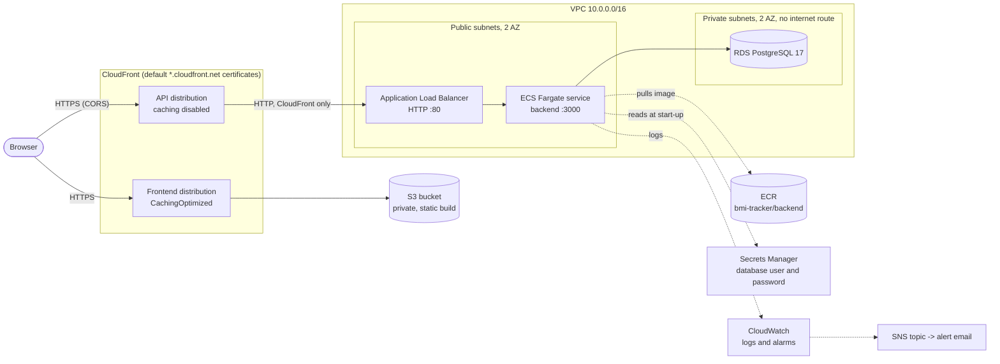
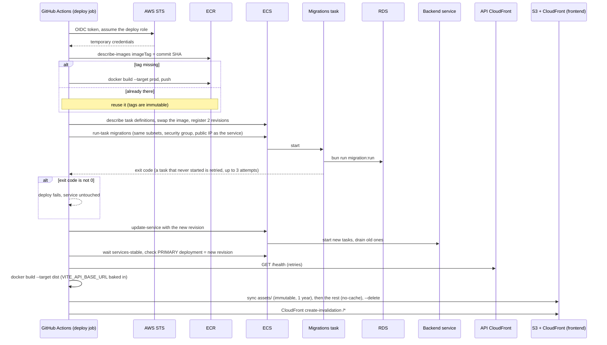

# Infrastructure

Terraform for AWS. Run every command from the repository root through `make`: Terraform and the AWS CLI run in the `terraform` and `aws` containers of `docker-compose.yml`, which read AWS credentials from the environment (`AWS_ACCESS_KEY_ID`, ...) or from `~/.aws` (`AWS_PROFILE`).

There are no deploy scripts. Terraform builds the infrastructure by hand with `make`; the application is shipped by `.github/workflows/deploy.yml`, whose steps are all written inline.

## Contents

- [What runs in AWS](#what-runs-in-aws)
- [Package layout](#package-layout)
- [Network and security](#network-and-security)
- [Terraform state](#terraform-state)
- [Create everything](#create-everything)
- [Deploying](#deploying)
- [Changing task settings](#changing-task-settings)
- [Rolling back](#rolling-back)
- [Security notes](#security-notes)
- [Monitoring](#monitoring)
- [Reference](#reference)
- [Destroying](#destroying)

## What runs in AWS

The frontend is a private S3 bucket behind CloudFront. The backend is a Fargate service behind an ALB; the ALB only accepts CloudFront's addresses, and a second CloudFront distribution puts HTTPS in front of it, since there is no domain. The database is RDS PostgreSQL in private subnets. Migrations are a one-shot ECS task. CloudWatch alarms notify `alert_email`, when set.



## Package layout

Three kinds of package: two **roots** (`bootstrap/`, `environments/prod/`), which are the only places Terraform is run, and the **modules** the prod root uses.

```text
infrastructure/
├── README.md
│
├── bootstrap/                       # root 1: the state bucket
│   ├── main.tf                      #   S3 bucket: versioning, encryption, no public access,
│   │                                #   prevent_destroy
│   ├── variables.tf                 #   aws_region, project
│   ├── outputs.tf
│   ├── backend.tf                   #   `backend "s3" {}`, written by the first bootstrap-apply
│   └── .terraform.lock.hcl          #   provider versions
│
├── environments/
│   └── prod/                        # root 2: the whole stack
│       ├── main.tf                  #   provider, default tags, one block per module
│       ├── variables.tf             #   every setting of prod, with defaults
│       ├── outputs.tf               #   URLs, bucket, distribution, role ARN, log groups
│       ├── backend.tf               #   `backend "s3" {}`, bucket and key passed by make
│       ├── terraform.tfvars.example #   optional overrides (terraform.tfvars is not tracked)
│       └── .terraform.lock.hcl
│
└── modules/                         # reusable pieces, never applied on their own
    ├── network/                     #   VPC, subnets, route table, security groups
    ├── rds/                         #   PostgreSQL instance and subnet group
    ├── ecr/                         #   image repository and lifecycle policy
    ├── iam/                         #   task execution role
    ├── alb/                         #   load balancer, target group, listener
    ├── backend-cdn/                 #   CloudFront in front of the ALB
    ├── frontend-static/             #   S3 bucket and CloudFront for the static build
    ├── ecs-backend/                 #   cluster, task definition, Fargate service, log group
    ├── ecs-migrations/              #   one-shot migrations task definition, log group
    ├── monitoring/                  #   SNS topic and CloudWatch alarms
    └── github-oidc/                 #   identity provider and the deploy role
```

Every module has the same three files: `main.tf` (resources), `variables.tf` (inputs, all documented) and `outputs.tf` (what other modules and the root read). A module never reads another module directly: the prod root passes one module's outputs to another's variables.

Not in git: `terraform.tfvars`, `.terraform/`, `.terraform-validate/` and any `*.tfstate`. The state lives in the S3 bucket (see [Terraform state](#terraform-state)).

The roots and what they hold:

- `bootstrap/` creates the S3 bucket that holds the Terraform state. Its first apply uses local state, because the bucket cannot hold its own state before it exists; the same `make` run then moves that state into the bucket (`bootstrap-migrate-state`, once), so no state file has to be kept by hand. The bucket is named `<project>-tfstate-<account id>`, and `make` works the name out from your AWS credentials (`TF_STATE_BUCKET=` overrides it).
- `modules/` are reusable pieces. They are never applied on their own.
- `environments/prod/` is the root module that wires the modules together, with its state in the bucket.

| Module            | Creates                                                                                              | Uses outputs of |
| ----------------- | ---------------------------------------------------------------------------------------------------- | --------------- |
| `network`         | VPC, 2 public and 2 private subnets, internet gateway, route table, the three security groups | none |
| `rds`             | PostgreSQL 17 instance, subnet group, master password in Secrets Manager | network |
| `ecr`             | `<project>/backend` repository: immutable tags, scan on push, keeps the 20 newest images | none |
| `iam`             | Task execution role (pull image, write logs, read the database secret) | rds |
| `alb`             | Load balancer, target group (health check on `/health`), HTTP listener | network |
| `backend-cdn`     | CloudFront distribution that gives the API HTTPS in front of the ALB | alb |
| `frontend-static` | Private S3 bucket, CloudFront distribution with origin access control | none |
| `ecs-backend`     | Log group, ECS cluster, backend task definition and Fargate service | ecr, iam, alb, rds, network, frontend-static (CORS origin) |
| `ecs-migrations`  | Log group and the one-shot migrations task definition | ecr, iam, rds |
| `monitoring`      | SNS topic, optional email subscription, five CloudWatch alarms | ecs-backend, rds, alb |
| `github-oidc`     | GitHub identity provider (optional) and the deploy role the workflow assumes | ecr, ecs-backend, ecs-migrations, iam, frontend-static |

## Network and security

| Subnets        | Range                          | Route                             | Hosts                          |
| -------------- | ------------------------------ | --------------------------------- | ------------------------------ |
| Public, 2 AZ   | `10.0.0.0/24`, `10.0.1.0/24`   | `0.0.0.0/0` to the internet gateway | the ALB and the backend tasks  |
| Private, 2 AZ  | `10.0.10.0/24`, `10.0.11.0/24` | none: no route to the internet    | RDS                            |

| Security group         | Accepts   | From                                          |
| ---------------------- | --------- | --------------------------------------------- |
| `<project>-alb`        | TCP 80    | CloudFront's origin-facing managed prefix list |
| `<project>-backend`    | TCP 3000  | the ALB group                                 |
| `<project>-database`   | TCP 5432  | the backend group                             |

Each security group accepts traffic only from the one before it. Nothing but CloudFront reaches the ALB, nothing but the ALB reaches the tasks, and nothing but the tasks reaches the database. Tasks run in public subnets with a public IP so they can pull images and read secrets without a NAT gateway; their security group does not let anything else in.

## Terraform state

`bootstrap/` applies first with local state and creates the bucket; `init -migrate-state` then moves its state into it and writes `bootstrap/backend.tf`. From then on both roots keep their state in the bucket, at `<project>/bootstrap/terraform.tfstate` and `<project>/prod/terraform.tfstate`. The bucket is versioned, encrypted, private and has `prevent_destroy`.

- Both roots keep their state in that one bucket, each under its own key. Locking uses S3 itself (`use_lockfile=true`), so there is no DynamoDB table.
- `make` passes bucket, key and region at init time, which is why `environments/prod/backend.tf` declares an empty `backend "s3" {}`.
- `make infra-validate` initialises each root without its backend, in a data directory of its own (`.terraform-validate`), so it never disconnects a root from its remote state.
- Terraform 1.17 (container image) and the AWS provider `~> 6.0`; both roots require Terraform `>= 1.10`.

## Create everything

```bash
make infra-apply      # one confirmation, at the end
```

That one command:

1. Creates the state bucket and moves the bootstrap state into it (first time only; no prompt).
2. Connects the prod root to that bucket.
3. Creates the ECR repository.
4. Builds the backend image and pushes it, only while the repository is empty: the ECS service cannot start without an image. From then on CI owns the images.
5. Shows the plan for everything else and applies it after you answer `yes`. RDS and CloudFront make it take 10 to 20 minutes.

It needs AWS credentials with enough permissions, Docker running, and an `origin` remote in git: the deploy role trusts the GitHub repository that `make` reads from it. `terraform.tfvars` is optional (copy `environments/prod/terraform.tfvars.example`):

- `alert_email`: who receives the CloudWatch alarms. Empty means nobody; AWS sends a confirmation link to click.
- `create_github_oidc_provider = false`: when the account already has GitHub's identity provider (only one is allowed).
- `github_repo`: only when it is not the `origin` remote.

Then:

```bash
make gh-vars          # prints the GitHub repository variables
```

1. Set the printed values as repository variables (Settings > Secrets and variables > Actions > Variables).
2. Publish the first release: push to `main`, or run the Deploy workflow by hand. It runs the migrations and publishes the frontend; until then the backend is up on an empty database and the frontend bucket is empty.
3. Commit the `infrastructure/bootstrap/backend.tf` that the first run wrote, so a fresh clone finds the state in the bucket. The local `bootstrap/terraform.tfstate` left behind can be deleted.

Running `make infra-apply` again later is safe: it re-applies bootstrap (no changes), skips the image, and applies whatever changed.

## Deploying

A push to `main` runs `.github/workflows/ci.yml`; when its three checks (`backend`, `frontend`, `infra`) pass, the `deploy` job calls `.github/workflows/deploy.yml`. Pull requests run the checks and never deploy. A newer push cancels the checks of an older pull request, but never a run on `main`.

Every deploy step is written inline in `deploy.yml`:

1. Builds the backend image and pushes it as the commit SHA. A tag that already exists is not pushed again.
2. Registers a task definition revision with the new image for the migrations task and for the backend.
3. Runs the migrations task to completion. A failure stops the deploy here, before the service is touched.
4. Moves the backend service to the new revision, waits until it is stable and checks that ECS did not roll it back.
5. Calls `/health` through the API's CloudFront address.
6. Builds the static frontend with `VITE_API_BASE_URL`, syncs it to S3 and invalidates CloudFront.



Settings of the workflow worth knowing:

- Only `main` may deploy; the deploy role trusts nothing else either.
- `concurrency: deploy` with no cancellation: two deploys at once would race on the migrations, so the second waits for the first.
- The job needs these repository variables, which `make gh-vars` prints: `AWS_REGION`, `AWS_ROLE_ARN`, `FRONTEND_BUCKET`, `FRONTEND_DISTRIBUTION_ID`, `VITE_API_BASE_URL`. `PROJECT` is optional, for when the resources are not named `bmi-tracker`.
- Running the workflow by hand redeploys the current commit without a new push and **skips the checks**, so use it deliberately.

Terraform is not part of that. Infrastructure changes are applied by hand:

```bash
make infra-plan
make infra-apply
```

## Changing task settings

Because CI registers its own task definition revisions, the task definitions ignore later changes to `container_definitions` and the service ignores `task_definition` (`lifecycle { ignore_changes }` in `modules/ecs-backend` and `modules/ecs-migrations`). Without that, an unrelated `terraform apply` would put back the image of Terraform's own state.

To change environment variables, secrets, cpu or memory of a task: drop the block, run `make infra-apply IMAGE_TAG=<the running tag>`, put the block back. Find the running tag with:

```bash
docker compose run --rm aws ecs describe-task-definition --task-definition bmi-tracker-backend \
  --query 'taskDefinition.containerDefinitions[0].image'
```

Migrations run while the previous tasks still serve traffic, so each one has to work with the old code too: add a column before the code uses it, drop it in a later release.

## Testing the pipeline

Use a pull request with a small change, so CI and CD run the way they will for real:

1. Push a branch and open a pull request against `main`. Only the checks run (`backend`, `frontend`, `infra`): the `deploy` job is skipped for a pull request, so nothing reaches AWS.
2. Merge it once the checks are green. The push to `main` runs the checks again and then calls `deploy.yml`.
3. Watch the `deploy` job in Actions. When it ends green, both addresses answer: `GET <VITE_API_BASE_URL>/health` returns `{"status":"ok"}` and the frontend URL (`make infra-output`) shows the app.

If the `Configure AWS credentials (OIDC)` step fails, the trust policy of the deploy role does not match the repository or the branch. CloudTrail records the token subject of the refused attempts (`AssumeRoleWithWebIdentity` events, `userIdentity.userName`).

## Rolling back

Revert the commit on `main`: the push deploys the previous code. Migrations are not reverted: undo one with a new migration.

The ECS service also has a deployment circuit breaker with rollback. If the new tasks never become healthy, ECS goes back to the previous revision by itself, and the deploy workflow fails because the primary deployment is not the one it started.

## Security notes

- The deploy role (`modules/github-oidc`) trusts only workflow runs on `github_branch` of `github_repo` (newer repositories carry the immutable owner and repository ids in the token subject, `repo:owner@123/name@456:...`, so the policy accepts both forms), and can only push to the backend repository, run the migrations task, update the backend service and publish the frontend. The deploy job must not declare a GitHub `environment`: that changes the token subject and the role would refuse it.
- The ALB security group accepts only CloudFront's managed prefix list, so the API cannot be reached over plain HTTP from anywhere else.
- Tasks run in public subnets with a public IP, to pull images and read secrets without a NAT gateway; their security group only accepts the ALB. The database accepts only the tasks.
- The database has `deletion_protection` on. To destroy it: set `db_deletion_protection = false`, apply, then `make infra-destroy`. The ECR repository and the frontend bucket are emptied on destroy; the state bucket has `prevent_destroy`.
- Branch protection is not in the repository: require the `backend`, `frontend` and `infra` checks on `main` in the GitHub settings.

The workflow gets AWS credentials with no stored secret. The deploy job requests a GitHub ID token (`id-token: write`) and calls `AssumeRoleWithWebIdentity` on the role `<project>-github-deploy`. AWS accepts the token only when `aud` is `sts.amazonaws.com` and `sub` is `repo:<github_repo>:ref:refs/heads/<github_branch>`. Any other branch, or a job that declares a GitHub `environment`, gets `AccessDenied`.

What the deploy role may do, and nothing more:

| Statement            | Allowed actions                                                            | On                                   |
| -------------------- | -------------------------------------------------------------------------- | ------------------------------------ |
| ECR login            | `ecr:GetAuthorizationToken`                                                | `*` (the API takes no resource)      |
| ECR push             | layer upload, `PutImage`, `DescribeImages`, `BatchGetImage` and related    | the repositories                     |
| Task definitions     | `DescribeTaskDefinition`, `RegisterTaskDefinition`                         | `*` (a new revision has no ARN yet)  |
| Run migrations       | `ecs:RunTask`                                                              | the migrations family, in this cluster only |
| Watch migrations     | `ecs:DescribeTasks`                                                        | tasks of this cluster                |
| Pass the role        | `iam:PassRole`                                                             | the task execution role, to `ecs-tasks.amazonaws.com` only |
| Deploy the backend   | `ecs:DescribeServices`, `ecs:UpdateService`                                | the backend service                  |
| Publish the frontend | `s3:PutObject`, `s3:DeleteObject`, `s3:ListBucket`                         | the frontend bucket                  |
| Invalidate           | `cloudfront:CreateInvalidation`                                            | the frontend distribution            |

The containers run without an AWS role: the app never calls an AWS API. The task execution role pulls the image, writes the logs and injects `DB_USER` and `DB_PASSWORD` from the database secret.

## Monitoring

Container logs go to CloudWatch (`/ecs/<project>-backend` and `/ecs/<project>-migrations`, kept 14 days). Alarms publish to the SNS topic `<project>-alerts`, which sends email to `alert_email` when it is set.

| Alarm                  | Fires when                                                    |
| ---------------------- | ------------------------------------------------------------- |
| `ecs-cpu-high`         | Backend CPU average above 80% for 3 minutes                   |
| `ecs-memory-high`      | Backend memory average above 80% for 3 minutes                |
| `rds-free-storage-low` | Free storage below 20% of the allocated, over 15 minutes      |
| `rds-connections-high` | Average database connections above 60 for 3 minutes           |
| `alb-5xx-high`         | More than 5 load balancer 5xx answers in a minute             |

Every alarm also notifies when it returns to normal.

## Reference

### Variables (`environments/prod/variables.tf`)

`make` already passes `aws_region`, `project`, `image_tag` and `github_repo`. Everything else has a default; override it in `terraform.tfvars` (ignored by git).

| Variable                      | Default         | Purpose                                                                  |
| ----------------------------- | --------------- | ------------------------------------------------------------------------ |
| `aws_region`                  | `us-east-1`     | Region of everything                                                     |
| `project`                     | `bmi-tracker`   | Name prefix of every resource                                            |
| `image_tag`                   | required        | Backend image tag the tasks start with; `make` passes `IMAGE_TAG`        |
| `alert_email`                 | empty           | Receives the CloudWatch alarms                                           |
| `github_repo`                 | required        | `owner/repo` allowed to deploy; `make` reads the `origin` remote         |
| `github_branch`               | `main`          | Branch allowed to deploy                                                 |
| `create_github_oidc_provider` | `true`          | Create GitHub's identity provider; an account can have only one          |
| `vpc_cidr`                    | `10.0.0.0/16`   | Address range of the VPC                                                 |
| `desired_count`               | `1`             | Copies of the backend task                                               |
| `task_cpu` / `task_memory`    | `256` / `512`   | Fargate CPU units and MiB                                                |
| `log_retention_days`          | `14`            | CloudWatch log retention                                                 |
| `db_name` / `db_username`     | `bmi` / `bmi`   | Database and master user; the password is generated by RDS               |
| `db_instance_class`           | `db.t4g.micro`  | Database instance size                                                   |
| `db_allocated_storage`        | `20`            | Database storage in GiB                                                  |
| `db_multi_az`                 | `false`         | Standby copy in another zone                                             |
| `db_deletion_protection`      | `true`          | Refuse to delete the database                                            |
| `db_skip_final_snapshot`      | `false`         | Skip the snapshot taken on destroy                                       |

### Outputs

`make infra-output` prints them all.

| Output                     | Meaning                                                              |
| -------------------------- | -------------------------------------------------------------------- |
| `frontend_url`             | Where the app answers                                                |
| `api_url`                  | Base URL of the API (`VITE_API_BASE_URL`)                            |
| `frontend_bucket_name`     | S3 bucket of the frontend (`FRONTEND_BUCKET`)                        |
| `frontend_distribution_id` | CloudFront distribution of the frontend (`FRONTEND_DISTRIBUTION_ID`) |
| `github_deploy_role_arn`   | Role the workflow assumes (`AWS_ROLE_ARN`)                           |
| `ecr_repositories`         | Repository URL of each image                                         |
| `ecs_cluster`, `ecs_service`, `ecs_migrations_family` | Names CI uses to deploy                   |
| `database_endpoint`        | Host and port; reachable from inside the VPC only                    |
| `database_secret_arn`      | Secret holding the database user and password                        |
| `log_groups`               | CloudWatch log groups of the backend and the migrations              |

### `make` targets

| Target                        | Purpose                                                                         |
| ----------------------------- | ------------------------------------------------------------------------------- |
| `infra-fmt`                   | Format the Terraform files                                                      |
| `infra-validate`              | Check formatting and validate both roots; needs no AWS access (CI runs it)      |
| `bootstrap-plan`              | Show what bootstrap would create                                                |
| `bootstrap-apply`             | Create the state bucket and move the bootstrap state into it                    |
| `infra-init`                  | Connect the prod root to its S3 state                                           |
| `infra-plan`                  | Show what Terraform would change in prod                                        |
| `infra-apply`                 | Create or update all of prod (`AUTO_APPROVE=true` skips the prompt)             |
| `infra-output`                | Print the URLs and the other outputs                                            |
| `gh-vars`                     | Print the GitHub Actions variables to set                                       |
| `infra-destroy`               | Destroy prod                                                                    |

## Destroying

The database has `deletion_protection` on, so turn it off first:

```bash
# in terraform.tfvars
db_deletion_protection = false
```

```bash
make infra-apply      # applies the new setting
make infra-destroy
```

The ECR repository and the frontend bucket are emptied on destroy. The state bucket has `prevent_destroy` and stays.
